  

  

  

01 **ABOUT**

Hey, I'm **MrHarry** — a developer working across **AI**, **software engineering** and **game development**, and a multi-time **hackathon prize-winner**.

I love turning bold ideas into real products and taking them all the way: solid logic under the hood, interfaces that look great, and the small details that make something feel finished. Modern, clean and well thought-out — never just "it works".

  

02 **WHAT I DO**

  

03 **TOOLKIT**

**AI & ML** — Python, reinforcement learning, AI agents & automation 
**Software Engineering** — Java, C#, JavaScript, HTML & CSS, Docker, Git 
**GameDev & 3D** — Unity, C#, Blender, 3D modeling

  <picture>
    <source media="(prefers-color-scheme: dark)" srcset="https://skillicons.dev/icons?i=py%2Cjava%2Ccs%2Cjs%2Chtml%2Ccss%2Cdocker%2Cgit%2Cunity%2Cblender&theme=dark&perline=10" />
    <source media="(prefers-color-scheme: light)" srcset="https://skillicons.dev/icons?i=py%2Cjava%2Ccs%2Cjs%2Chtml%2Ccss%2Cdocker%2Cgit%2Cunity%2Cblender&theme=light&perline=10" />
    
  </picture>

04 **SELECTED WORK**

[AuditEnv](https://github.com/Beka486/audit-rl-env) 
Reproducible reinforcement-learning environment for training AI financial auditors — synthetic ledgers with hidden booking errors, five investigation tools and an evidence-based reward from an isolated grader. Pure Python standard library: no network, no GPU, no paid APIs.

[Aqbobek AI Agent](https://github.com/Beka486/AIS_HACK-3.0) 
Built at AIS Hack 3.0 (HealthTech & RPA track) — an external AI/RPA agent shipped as a Chrome extension (Manifest V3) that operates a mock clinical information system directly through the DOM.

[Premium URL Shortener](https://github.com/Beka486/Premium-URL-Shortener-) 
A clean, premium-styled link shortener interface built with HTML & CSS.

<strong>open the project map</strong>

 

| Project | Focus | Stack |
| :-- | :-- | :-- |
| AuditEnv | RL environment for AI auditors | Python · stdlib · Docker |
| Aqbobek AI Agent | AI / RPA agent for healthcare | JavaScript · Chrome MV3 |
| Premium URL Shortener | Link shortener UI | HTML · CSS |

05 **NOW**

Leveling up across AI, software engineering and game dev — shipping new projects and hunting the next hackathon win.

06 **ACTIVITY**

  <picture>
    <source media="(prefers-color-scheme: dark)" srcset="https://streak-stats.demolab.com?user=Beka486&theme=dark&hide_border=true&background=0D1117&ring=A77BFF&fire=4F8CFF&currStreakNum=E6EDF3&currStreakLabel=8AB4FF&sideNums=E6EDF3&sideLabels=C9D1D9&dates=8B949E&stroke=30363D" />
    <source media="(prefers-color-scheme: light)" srcset="https://streak-stats.demolab.com?user=Beka486&hide_border=true&background=FFFFFF&ring=7C5CFF&fire=4F8CFF&currStreakNum=1F2328&currStreakLabel=4F6BFF&sideNums=1F2328&sideLabels=424A53&dates=6E7781&stroke=D0D7DE" />
    
  </picture>

  <picture>
    <source media="(prefers-color-scheme: dark)" srcset="https://raw.githubusercontent.com/Beka486/Beka486/output/github-snake-dark.svg" />
    <source media="(prefers-color-scheme: light)" srcset="https://raw.githubusercontent.com/Beka486/Beka486/output/github-snake.svg" />
    
  </picture>

 

Open to collaboration in AI, game development and developer tools — let's build something that feels great to use.

  

